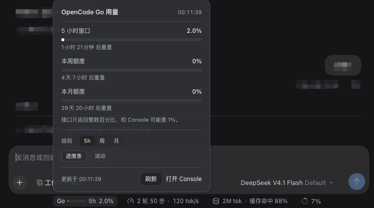
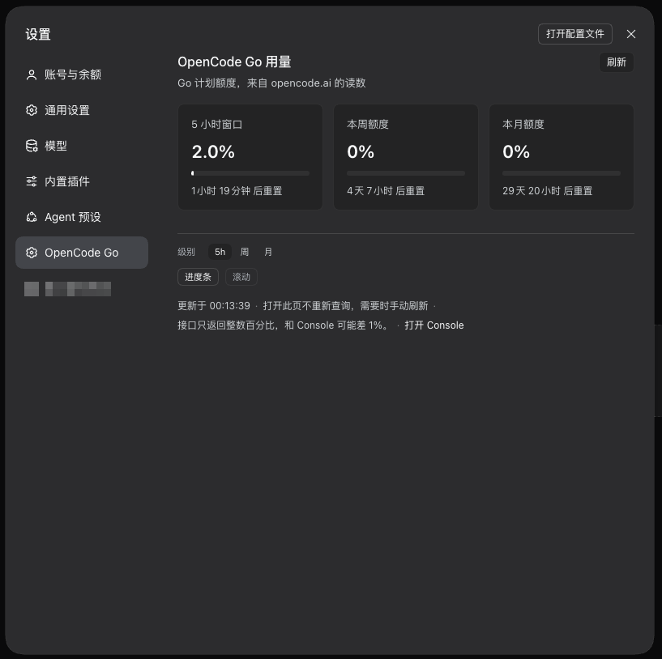

# OpenCode Go Usage

English | [中文](README.zh.md)

A lightweight DSH plugin built for one job: showing your **OpenCode Go** usage.
It adds one pill to the composer dock and one page to Settings — no other surface,
no dependencies, no build step.





## What it shows

- **Composer dock** — a compact `Go [bar] 5h 13%` pill, left of the Turn-count
  pill. The bar can be hidden, the level it tracks (`5h` / week / month) is
  configurable, and it can rotate between levels on a timer.
- **Hover, click or focus** opens a panel with all three allowances: one bar each,
  used percentage, reset countdown, a manual refresh, and the bar / level / rotation
  controls. Changes are saved in the browser.
- **Settings → OpenCode Go** — three cards, cache-first, refreshed on demand.
- **Bilingual** — the UI follows the Harness app language (Chinese and English
  dictionaries are both registered).

## Install

The repository is itself an installable bundle (`package.json` declares
`dsh.bundle`). Point the Harness plugin manager at this directory or the GitHub
repository. After installing, reload the page: the `Go` pill appears under the
composer and an "OpenCode Go" section appears in Settings.

Requires DeepSeek Harness 0.2.x (the `dsh.client`, `ctx.slots` and `ctx.locale`
contracts).

## Where the API key comes from

Resolved per request, in this order — no key needs to be written into the plugin:

1. `config.apiKey` on the plugin row, if set.
2. The credential behind `config.apiKeyEnv` (default `OPENCODE_GO_API_KEY`) — the
   same key the Models page stores for the `opencode-go` provider.
3. A process environment variable of that name.

## Configuration

```yaml
- id: opencode-go-usage
  name: 'dsh-opencode-go-usage'
  config:
    apiKeyEnv: OPENCODE_GO_API_KEY   # credential reference
    # apiKey: oc_sk_...              # literal key, not recommended
    path: /dsh-opencode-go/usage     # Host read-only route
    cacheSeconds: 60                 # host cache window, also the dock poll period

    dock: true          # dock pill on/off
    bar: true           # progress bar inside the pill
    level: rolling      # tracked level: rolling (5h) | weekly | monthly
    rotate: false       # rotate the tracked level
    rotateSeconds: 5    # rotation period (minimum 2s), only with rotate: true
```

`level` also accepts `week`/`w`/`周` and `month`/`m`/`月`; anything unknown falls back
to `rolling`. Changes require reloading the Harness (restart the app or re-enable
the bundle).

## Refresh and caching

| Surface | Request | Behaviour |
| --- | --- | --- |
| Dock pill | `GET /dsh-opencode-go/usage` | Every 60s; served from the host cache while it is fresh |
| Panel "Refresh" | `GET …?refresh=1` | Skips the cache, queries upstream |
| Settings opened | `GET …?cache=1` | Uses whatever is cached, even if old; queries only when nothing was cached |
| Settings "Refresh" | `GET …?refresh=1` | Queries upstream |

A credential change (`credentials/reference-updated`) drops the cache, so a new key
is read on the next request instead of showing the previous account's numbers.

## HTTP route

`GET /dsh-opencode-go/usage` (`?refresh=1` forces, `?cache=1` cache-only):

```json
{
  "ok": true,
  "fetchedAt": "2026-11-04T12:40:00.000Z",
  "credentialSource": "stored",
  "dock": true,
  "display": { "bar": true, "level": "rolling", "rotate": false, "rotateSeconds": 5 },
  "servedFromCache": true,
  "stale": false,
  "usage": {
    "rolling": { "status": "ok", "percent": 12.5, "resetsAt": "2026-11-04T17:33:21.000Z" },
    "weekly":  { "status": "ok", "percent": 4.1,  "resetsAt": "2026-11-09T00:00:00.000Z" },
    "monthly": { "status": "ok", "percent": 1.2,  "resetsAt": "2026-12-04T12:23:50.000Z" }
  }
}
```

Failures return `{ "ok": false, "error": { "code": "NO_KEY|UNAUTHORIZED|FORBIDDEN|TIMEOUT|NETWORK|UPSTREAM|SHAPE", "message": "…" } }`.

## Notes

- The plugin reads `https://opencode.ai/zen/go/v1/usage` with the key you already
  stored. The key never reaches the page: the browser only receives percentages
  and reset times.
- The readings are the provider's own integers. The Console page can differ by one
  percentage point; the panel says so.
- The route is a read-only same-origin GET and does not pass the Harness browser
  login gate. Harness listens on loopback by default; if you expose it to a LAN or
  a tunnel, this route becomes reachable too.
- Bar colours use the theme tokens (`--dsw-alias-*`), so light and dark themes both
  apply.

## License

MIT — see [LICENSE](LICENSE).
