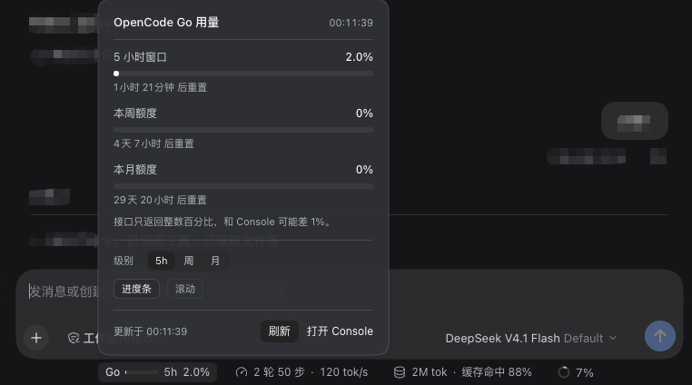
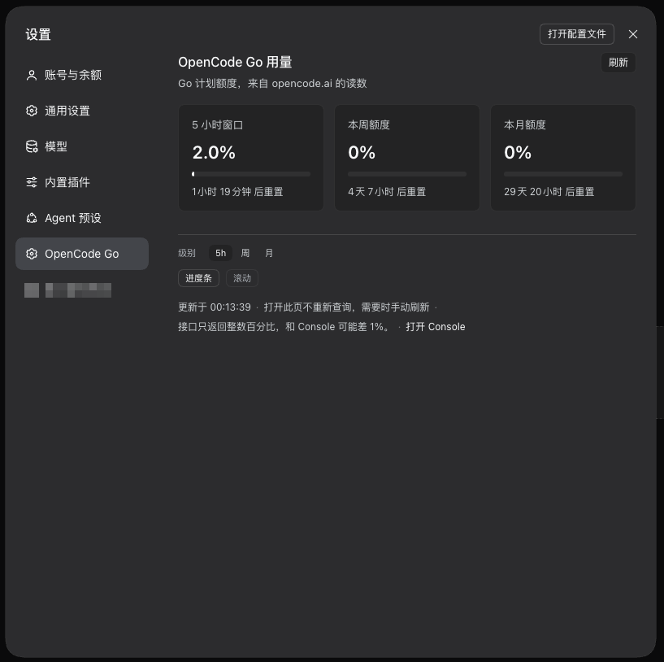

# OpenCode Go 用量

[English](README.md) | 中文

一个轻量的 DSH 插件，只做一件事：查看你的 **OpenCode Go** 用量。
一个输入框底栏徽标、一个设置页，不占别的位置，零依赖，无需构建。





## 显示什么

- **输入框底栏**：`Go [进度条] 5h 13%` 紧凑徽标，位于轮数左侧。进度条可隐藏，
  跟踪的级别（`5h` / 周 / 月）可配置，也可以按定时轮换。
- **悬停 / 点击 / 聚焦**展开面板：三个额度各一条进度条、已用百分比、重置倒计时、
  手动刷新，以及进度条 / 级别 / 轮换开关。改动保存在浏览器本地。
- **设置 → OpenCode Go**：三张卡片。打开时先读缓存、不额外查一次，之后每 60 秒自动刷新；
  按钮只用于立刻取一次。
- **中英双语**：跟随 Harness 应用语言，注册了中文与英文两套词条。

## 安装

仓库本身就是可安装的 bundle（`package.json` 声明了 `dsh.bundle`）。在 Harness 的插件
管理里指向本目录或 GitHub 仓库即可。安装后刷新页面：底栏出现 `Go` 徽标，设置里出现
「OpenCode Go」一节。

需要 DeepSeek Harness 0.2.x（`dsh.client`、`ctx.slots`、`ctx.locale` 契约）。

## 密钥从哪里来

按下面的顺序逐次解析，不需要把密钥写进插件配置：

1. 插件行 `config.apiKey`（显式填写时优先）。
2. 凭据服务里的 `config.apiKeyEnv` 引用，默认 `OPENCODE_GO_API_KEY`——也就是
   「设置 → 模型」里为 `opencode-go` 保存的那把密钥。
3. 同名进程环境变量。

## 配置项

```yaml
- id: opencode-go-usage
  name: 'dsh-opencode-go-usage'
  config:
    apiKeyEnv: OPENCODE_GO_API_KEY   # 凭据引用名
    # apiKey: oc_sk_...              # 也可以直接写死，不推荐
    path: /dsh-opencode-go/usage     # Host 只读路由
    cacheSeconds: 60                 # 宿主缓存秒数，也是底栏刷新周期

    dock: true          # 底栏徽标总开关
    bar: true           # 徽标里的进度条
    level: rolling      # 跟踪级别：rolling (5h) | weekly | monthly
    rotate: false       # 级别轮换显示
    rotateSeconds: 5    # 轮换间隔（最小 2 秒），仅 rotate: true 时生效
```

`level` 也接受 `week`/`w`/`周` 与 `month`/`m`/`月`；无法识别时回落到 `rolling`。
配置改动需要重载 Harness（重启应用或重新启用该 bundle）后生效。

## 刷新与缓存

| 场景 | 请求 | 行为 |
| --- | --- | --- |
| 底栏徽标 | `GET /dsh-opencode-go/usage` | 每 60 秒拉一次；宿主缓存未过期时直接返回缓存 |
| 面板「刷新」 | `GET …?refresh=1` | 跳过缓存，强制向上游查询 |
| 设置页打开 | `GET …?cache=1` | 有缓存就用缓存（哪怕过期），只有从未读过时才查上游 |
| 设置页保持打开 | `GET /dsh-opencode-go/usage` | 每 60 秒自动刷新，与底栏同一节奏 |
| 设置页「刷新」 | `GET …?refresh=1` | 立刻查一次上游 |

凭据变化（`credentials/reference-updated`）会清空缓存，换 key 后下一次请求就用新凭据，
不会继续显示上一个账号的数字。

## 接口

`GET /dsh-opencode-go/usage`（`?refresh=1` 强制刷新，`?cache=1` 只读缓存）：

```json
{
  "ok": true,
  "fetchedAt": "2026-11-04T12:40:00.000Z",
  "credentialSource": "stored",
  "dock": true,
  "display": { "bar": true, "level": "rolling", "rotate": false, "rotateSeconds": 5 },
  "servedFromCache": true,
  "stale": false,
  "usage": {
    "rolling": { "status": "ok", "percent": 12.5, "resetsAt": "2026-11-04T17:33:21.000Z" },
    "weekly":  { "status": "ok", "percent": 4.1,  "resetsAt": "2026-11-09T00:00:00.000Z" },
    "monthly": { "status": "ok", "percent": 1.2,  "resetsAt": "2026-12-04T12:23:50.000Z" }
  }
}
```

失败时返回 `{ "ok": false, "error": { "code": "NO_KEY|UNAUTHORIZED|FORBIDDEN|TIMEOUT|NETWORK|UPSTREAM|SHAPE", "message": "…" } }`。

## 说明

- 插件用你已经保存的密钥读取 `https://opencode.ai/zen/go/v1/usage`，密钥不会进入页面：
  浏览器只收到百分比和重置时间。
- 读数就是接口返回的整数百分比，与 Console 最多差 1 个百分点，面板上有对应说明。
- 路由是只读、同源的 GET，不经过 Harness 的浏览器登录闸门。Harness 默认只监听回环
  地址；若你把它暴露到局域网或隧道，这条路由也会随之可达。
- 进度条颜色使用主题 token（`--dsw-alias-*`），明暗主题都适用。

## 开源协议

MIT，见 [LICENSE](LICENSE)。
